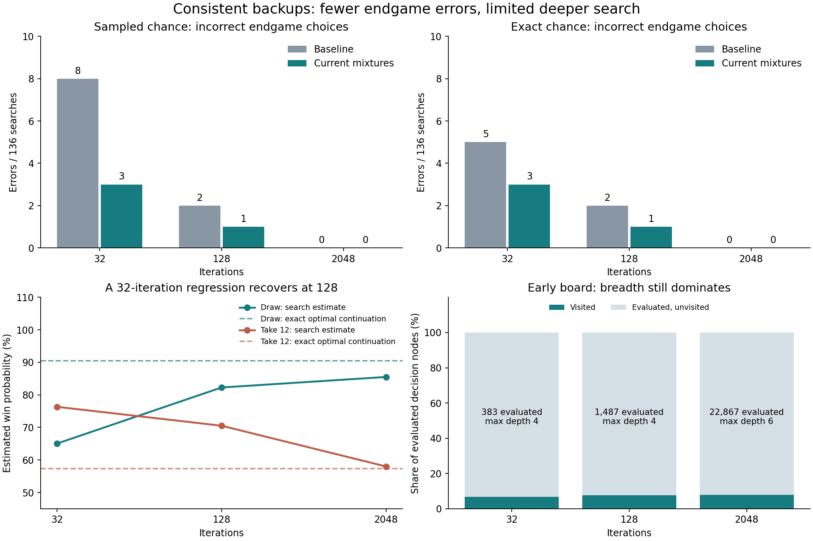

# Current-mixture MCTS backups: implementation and case studies

October 11, 2026. The refactor replaces historical return accumulation with current
child mixtures while keeping traversal counts separate. All 960 replayed searches
satisfied the new mixture identities to within **1.79e-7**. Endgame errors decreased
at small budgets, but individual regressions remain and earlier-game action choices
did not change. Subsequent full-game faceoffs did not establish a strength gain.
The reason to retain this refactor is consistent value accounting.



## What changed

Decision values retain one neural contribution and mix current action values by
action visits. Exact afterstates use known probabilities; sampled afterstates use
observed outcome frequencies. Boundaries pool individual outcome evaluations.
Backup refreshes these estimates bottom-up rather than treating successive versions
of a running mean as independent new returns. The root and pre-evaluated outcomes
retain neural weight one without receiving initialization visits.

Selection rules, chance sampling, boundary batch schedules and public search
configuration are unchanged. Changed values can nevertheless change FPU, subsequent
search allocation and which random outcomes are consumed on each branch. This
experiment bundles the backup change and consistent neural initialization; it does
not isolate their causal contributions.

## Protocol and aggregate results

Replayed all 17 saved exact-endgame boards with eight seeds each, plus eight
earlier-game boards with three seeds each, at 32, 128 and 2048 iterations in both
sampled and exact chance modes: **960 new searches paired with 960 saved baseline
searches**. Every pair used the same frozen state, checkpoint and initial RNG seed.
Search used `c_puct=1`, no Dirichlet noise, symmetry merging disabled,
`boundary_samples=1`, and `NextDealEvaluator`. These are the original diagnostic
settings, not a test of default symmetry merging or larger boundary batches.

Baseline: `d5d0c84`, verified against the original source SHA256
`33ed6099c66797e4b7fe70be4686120bd6aee2dba458fe9f0de95d34f3465eb1`.
Checkpoint: boundary-trained iteration 119, SHA256
`dcbe5ec51a529460de5c8f6ad91d37fcdef5e0e83f183474832976c3be5d976f`.
Exact endgame references were independently recomputed by the original probe.

Regret is the exact optimal action value minus the exact value of the chosen
action, assuming optimal continuation. Percentage points below refer to win
probability, not relative percentage change.

| Chance mode | Iterations | Wrong choices, before → after / 136 | Mean regret, before → after (pp) |
|---|---:|---:|---:|
| Sampled | 32 | 8 → 3 | 0.554 → 0.170 |
| Sampled | 128 | 2 → 1 | 0.154 → 0.053 |
| Sampled | 2048 | 0 → 0 | 0 → 0 |
| Exact | 32 | 5 → 3 | 0.378 → 0.355 |
| Exact | 128 | 2 → 1 | 0.154 → 0.053 |
| Exact | 2048 | 0 → 0 | 0 → 0 |

For earlier-game positions, **0/24 selected action groups changed at every budget
in either mode**, after accounting for equivalent slots. Exact-mode root values
changed by up to 2.22 pp at 2048 iterations. No exact reference is available for
those earlier-game values.

## Case 1: the largest action-quality change is a regression at 32 iterations

`last-turn-1650878`, repetition 5, seed `3855619947`, exact chance. The visible
discard is 12; the active player is seat 1. The engine stores the acting player's
board first. It is the final turn before round completion:

```text
Acting board          Opponent board
 1   3  -1   ?        11   3  11   5
-2   1   2  -1         1   4  -2   0
 6   1   2  12         2   5   0   0
```

Exact optimal-continuation win probabilities are **90.46% for draw** and **57.28%
for take 12**. At 32 iterations the baseline chooses draw, but the new search
chooses take, losing **33.18 pp** of exact action value.

| Iterations | Baseline draw Q / visits | New draw Q / visits | Baseline take Q / visits | New take Q / visits | New choice |
|---:|---:|---:|---:|---:|---|
| 32 | 73.72% / 22 | 65.04% / 13 | 60.02% / 10 | 76.33% / 19 | Take |
| 128 | 85.81% / 110 | 82.27% / 89 | 66.68% / 18 | 70.52% / 39 | Draw |
| 2048 | 85.54% / 1977 | 85.51% / 1973 | 57.05% / 71 | 58.00% / 75 | Draw |

At 32 iterations, **9/15 draw outcomes have no continuation visits** in the new
tree, versus 7/15 in the baseline. The remaining draw branches have very little
evidence, while take's estimate is optimistic. Retaining neural contributions
also moderates sparse outcome estimates: on this same new tree, removing the
neural contribution only from visited draw outcomes would raise draw's mixture
from 65.04% to 67.21%, still below take's 76.33%. This is an accounting
counterfactual, not a rerun or an isolated causal explanation.

The regression occurs in **one of eight seeds** for this board at 32 iterations;
all eight choose correctly at 128 and 2048. Consistent backup does not guarantee
correct allocation with sparse conditional estimates. Also, search Q averages
explored continuations; it need not equal the optimal-continuation oracle at a
finite budget.

An improvement example is `terminal-330633`, sampled chance, repetition 1:
at 32 iterations the choice changes from replacing row 3/column 1 to row 2/column
3 (human, one-based coordinates). Their exact values are 18.18% and 34.34%, a
**16.16 pp** improvement. This position has no afterstate: changed neural/FPU
bookkeeping and subsequent allocation can matter even at terminal boundaries.

## Case 2: a large value correction without an action change

`terminal-174967`, repetition 0, seed `2581521881`, sampled chance at 2048.
The incoming card is 6. The acting board is:

```text
6  -1  12   ?
0   9  10   0
3   0   1   6
```

Replacing row 2/column 3 has an exact win probability of **87.25%**. Its estimate
changes from **72.97% on 37 samples** to **88.51% on 87 samples**: a **15.53 pp**
shift, reducing absolute error from 14.28 to 1.25 pp. This is the largest absolute
action-value shift at 2048 among actions with at least 32 visits in both versions.

Both searches choose row 1/column 3, an exact 100% action. Better estimates for
alternatives therefore do not imply a stronger chosen move. Since these are
single-sample boundary visits, both versions already pool that action's outcomes
equivalently; this correction reflects changed allocation and sampled outcomes,
not removal of averaging within the boundary itself. Exact chance mode produces
the same result here because this search contains only boundary children.

## Case 3: many evaluations still buy little depth

`general-997508`, repetition 0, seed `1624246624`, exact chance. This is an early
draw/take decision with 19 hidden cards across both boards and a visible discard
of 3. Both versions choose draw at every budget.

| Iterations | New evaluated decision nodes | With zero visits | Maximum evaluated action depth | Boundary visits |
|---:|---:|---:|---:|---:|
| 32 | 383 | 357 (93.2%) | 4 | 0 |
| 128 | 1487 | 1373 (92.3%) | 4 | 0 |
| 2048 | 22867 | 21039 (92.0%) | 6 | 0 |

Depth counts game actions, excluding the extra chance-node edge; it is a maximum,
not typical depth or complete turns. At 2048 the draw estimate changes only from
36.57% to 36.59%. Across all 24 earlier-game exact searches at this budget,
**86.54%** of evaluated decisions have zero visits and mean maximum action depth
is **7.29**. Enumerating outcomes initializes values across the tree but does not
search all their continuations deeply.

## Full-game checks and deferred strategies

Using the same iteration-119 checkpoint, eight CPU workers played 128 games per
budget against the historical backup (`d5d0c84`), with 64 environment seeds in both
seats. Both sides used sampled chance, `boundary_samples=1`, `c_puct=1.5`,
FPU reduction 0.1, symmetry merging, temperature zero and no root noise.

| Iterations | New wins / ties / losses | New win credit (paired 95% interval) | Old minus new score (paired 95% interval) |
|---:|---:|---:|---:|
| 32 | 58 / 1 / 69 | 45.70% (38.28–53.13%) | −3.21 (−9.49 to +3.02) |
| 128 | 62 / 1 / 65 | 48.83% (40.62–57.42%) | −0.35 (−6.77 to +6.23) |

Intervals use 20,000 bootstrap resamples of whole seat pairs, seed 20261011.
Neither comparison establishes improvement, regression or equivalence. Lower
Skyjo scores are better, so positive score margins favor the new search.

This configuration is a weak test of the backup correction: with sampled chance
and one boundary sample per visit, current mixtures reconstruct historical
fresh-return averages along the same trajectory, except for the retained root
neural contribution. That contribution changes FPU; floating-point differences
can also change tie-breaking and subsequent random draws. A 50-search ablation
removing only the root neural contribution reproduced the old root visit
allocation in 49 cases. Exact chance and larger initial boundary batches expose
the accounting difference more directly.

A separate 256-game comparison at 32 iterations tested action coverage,
best-child backups and highest-Q final selection together against current mixture
search. Both used exact chance and an initial boundary batch of 10. The candidate
scored 128 wins, 2 ties and 126 losses: 50.39% credit (43.95–56.64%), with worse
average scores (current minus candidate −5.64, interval −10.89 to −0.38).
This bundled experiment does not establish which change caused the result.
These strategies remain local experiments; this refactor adds none of them.

## Work, timing and verification

Earlier-game means at 2048 iterations:

| Chance mode | Evaluated states, before → after | Evaluator calls, before → after | Seconds/search, before → after |
|---|---:|---:|---:|
| Sampled | 2049.0 → 2048.9 | 2049.0 → 2048.9 | 1.434 → 1.520 |
| Exact | 15040.5 → 15063.6 | 2047.9 → 2047.7 | 4.240 → 4.336 |

The new replay completed in approximately 92 seconds with four workers. Search
timings exclude tree audits but compare separate historical runs, include changes
in tree allocation, and were collected while other verification work could run.
They are not a controlled measurement of backup overhead.

All 960 root visit budgets and outgoing-visit totals match. Every evaluated
decision and expanded chance node was checked against its current mixture.
Scripted tests separately cover larger initial boundary batches, fixed-seat FPU,
terminal ties/caching, fresh continuing-round samples, exact versus empirical
weights, probability-one transitions, falling/rising estimates, and initialization
without fake visits. The changed boundary regression failed in all three budget
cases before the production change and passed afterward.
The probability-one/falling-and-rising regression also failed in all eight cases
against the pre-change source. The original implementation passed all 51 focused
search tests and all 319 repository tests. The full suite required shared-memory
access outside the sandbox; lint and whitespace checks passed for the changed
production/tests.
Before committing onto the current self-play branch, validation was repeated:
**66 focused search/boundary/full-game tests and all 333 repository tests passed**.

Reproduction scripts, manifests, source snapshots, raw rows and analysis are in
`.runs/diagnostics/mcts-mixture-20261011/`; the baseline rows remain unchanged in
`.runs/diagnostics/mcts-case-studies-20261011/`. Run `replay.py` followed by
`analyze.py` and `figure.py` with the repository's Python environment. `analysis.json`
contains every paired action comparison. The production source differs from the
replayed source snapshot only in formatting and comments, verified by an AST
comparison.

[Committed evidence](evidence/mcts-mixture-backups.json) preserves selected report
fields, settings and source hashes. Full replay inputs and diagnostic scripts are
local artifacts, not bundled reproduction assets. The case studies remain a
selected cohort with repeated seeds, not a random held-out strength evaluation.
The faceoffs used frozen weights; no retraining was performed.
